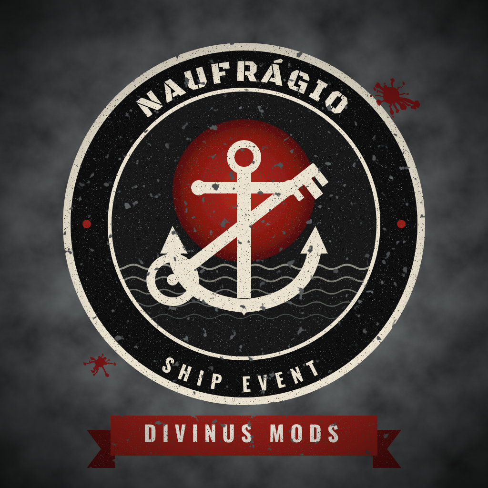

# Divinus-Ship-Event
NAUFRÁGIO - Ship Event | by DivinuS Mods

# NAUFRÁGIO – Ship Event



**Evento de naufrágio para servidores DayZ — por DivinuS Mods**

Um navio cargueiro naufraga perto da costa trazendo um contêiner trancado cheio de carga. Para abrir, os jogadores precisam enfrentar os zumbis do navio e derrotar o **BOSS**, que carrega a única chave do contêiner. A chave abre o contêiner **uma única vez** e quebra.

> English summary at the end of this page.

---

## Recursos

- Naufrágio automático com tempo configurável (padrão: primeiro aos 30 min, depois a cada 30 min)
- Navio encalhado em água rasa, com fumaça e som de naufrágio quando o jogador se aproxima
- Contêiner trancado nas cores vermelho, azul, amarelo ou laranja, com carga no convés
- Loot vanilla padrão já configurado e fácil de editar
- Zumbis no navio, com quantidade e tipos configuráveis
- **BOSS** com vida configurável, recompensa extra e proteção contra finalização pelas costas
- **Chave de uso único**: abre o contêiner do naufrágio e quebra (contêineres do mapa não são afetados)
- Notificação na tela **uma única vez** por naufrágio, com local e coordenadas
- Marcadores de mapa para Expansion, BasicMap e LBmaster (opcionais)
- Limpeza automática do naufrágio sem jogadores por perto e remoção de restos após reinício
- Sistema completo de logs
- Comando de chat para admins (por SteamID)
- 23 pontos de água rasa do DeerIsle já incluídos; funciona em qualquer mapa

## Como funciona

1. No horário do evento, o mod escolhe um ponto livre do `Locais.json` (pontos em terra são pulados e avisados no log).
2. O navio aparece com um contêiner trancado no convés e a carga é preenchida com itens do `Loot.json`.
3. Os zumbis e o BOSS aparecem no navio. A chave do contêiner fica com o BOSS.
4. Todos os jogadores online recebem uma notificação, uma única vez.
5. Quem matar o BOSS pega a chave, destranca o contêiner e a chave quebra.
6. Sem jogadores por perto pelo tempo configurado, o naufrágio inteiro é removido.

## Instalação (servidor)

1. Copie a pasta `@DivinusShipEvent` para a pasta do servidor.
2. Copie a chave (`.bikey`) da pasta `keys` do mod para a pasta `keys` do servidor.
3. Adicione ao parâmetro de inicialização: `-mod=@DivinusShipEvent` (é `-mod`, não `-serverMod`).
4. Ligue o servidor. As configurações são criadas em `Profiles/DivinusMods/ShipEvent/`.
5. Recomendado: cole o conteúdo de `types_chaves.xml` no `db/types.xml` da sua missão (as chaves que ainda não existirem).

## Configuração

Todos os arquivos ficam em `Profiles/DivinusMods/ShipEvent/`. Valores `1` = ligado, `0` = desligado.

### Config.json (principais campos)

| Campo | Padrão | O que faz |
|---|---|---|
| `EventoAtivo` | 1 | Liga/desliga os naufrágios automáticos |
| `MinutosAtePrimeiroEvento` | 30 | Minutos até o primeiro naufrágio após ligar o servidor |
| `IntervaloEntreEventosMinutos` | 30 | Minutos entre um naufrágio e o próximo |
| `MaximoNaufragiosAtivos` | 2 | Quantos naufrágios podem existir ao mesmo tempo |
| `MinutosParaSumirSemJogadores` | 45 | Tempo sem jogadores por perto até o naufrágio sumir |
| `RaioJogadorPerto` | 150 | Distância (m) que conta como jogador perto |
| `PularLocaisEmTerra` | 1 | Pula pontos que estiverem em terra |
| `UsarMarAleatorioSeFaltarLocal` | 0 | Procura um ponto de mar aleatório se nenhum ponto estiver livre |
| `NotificacaoAtiva` | 1 | Liga/desliga a notificação |
| `NotificacaoTitulo` / `NotificacaoMensagem` | — | Texto da notificação (`{LOCAL}`, `{X}`, `{Z}`) |
| `CoresContainer` | 4 cores | Cores sorteadas para o contêiner |
| `LootMinimoItens` / `LootMaximoItens` | 10 / 15 | Quantidade de itens da carga |
| `ZumbisAtivos` / `QuantidadeZumbis` | 1 / 8 | Zumbis no navio |
| `TiposZumbis` | lista | Tipos de zumbi (qualquer classe do jogo ou de mods) |
| `BossAtivo` | 1 | Cria o BOSS (a chave fica só com ele) |
| `BossTipo` | `ZmbM_usSoldier_Heavy_Woodland` | Classe do BOSS |
| `BossVida` | 1000 | Vida total do BOSS (zumbi normal = 100) |
| `BossRecompensaExtra` | lista | Itens extras no inventário do BOSS |
| `DerrubarChaveAoMorrer` | 0 | 1 = a chave cai no chão ao lado do corpo do BOSS |
| `ChaveUsoUnico` | 1 | A chave quebra depois de abrir o contêiner |
| `ApagarChaveQuebrada` | 1 | A chave quebrada some do inventário |
| `MarcadorExpansion` / `MarcadorBasicMap` / `MarcadorLBMaster` | 1 | Marcadores de mapa (se o mod estiver instalado) |
| `ComandoChatAtivo` / `ComandoChat` / `AdminsSteamID` | 1 / `/naufragio` / lista | Comando de admin |
| `LogsDetalhados` | 1 | Mais detalhes no log |

### Locais.json

```json
{
    "Locais": [
        { "Nome": "Costa Norte", "Posicao": [7492.0, 0.0, 14108.0], "Rotacao": -1.0 }
    ]
}
```

- `Posicao`: `[X, 0, Z]` — a altura é calculada pelo mod.
- `Rotacao`: direção do navio em graus; `-1` = aleatória.

### Loot.json

```json
{
    "Itens": [
        { "Item": "AKM", "Extras": ["Mag_AKM_30Rnd", "AmmoBox_762x39_20Rnd"] }
    ]
}
```

Cada `Item` vai para a carga junto com seus `Extras`. Itens de outros mods funcionam se o mod estiver no servidor.

## Logs

Pasta `Profiles/DivinusMods/ShipEvent/Logs/` — um arquivo por início do servidor. Registra configuração carregada, erros de nomes de itens/zumbis, local escolhido, contêiner e chave, loot, zumbis, BOSS, notificação, jogadores que chegaram, morte do BOSS, abertura do contêiner, quebra da chave e limpeza. As mesmas linhas aparecem no `script.log` com o prefixo `[DivinuS ShipEvent]`.

## Comandos de admin

Somente para os SteamIDs em `AdminsSteamID`:


## Compilar

Empacote a pasta `DivinusShipEvent` com o Addon Builder do DayZ Tools usando o prefixo `DivinusShipEvent` e assine o PBO com a sua chave.

## Estrutura do repositório

```
DivinusShipEvent/               código-fonte do mod (config.cpp, scripts, som, ícone)
profiles/DivinusMods/ShipEvent/ arquivos de configuração de exemplo
types_chaves.xml                cadastro das chaves para o types.xml
imagens/                        imagens do projeto
```

---

## English summary

**Shipwreck event for DayZ servers — by DivinuS Mods.** A cargo ship runs aground near the coast carrying a locked container. Players fight the infected on board and defeat the **BOSS**, who carries the only key. The key opens the container **once** and breaks.

- Configurable timer, spawn spots (23 DeerIsle spots included), loot, infected, boss health and rewards
- One-time on-screen notification, optional map markers (Expansion, BasicMap, LBmaster)
- Automatic cleanup, full logs and admin chat commands
- Install: copy `@DivinusShipEvent` to the server, copy the key to `keys`, add `-mod=@DivinusShipEvent`
- Config files are created in `Profiles/DivinusMods/ShipEvent/` (field names are in Portuguese)

---

**© DivinuS Mods.** Reupload ou repack sem autorização não é permitido. / Reupload or repack without permission is not allowed.

